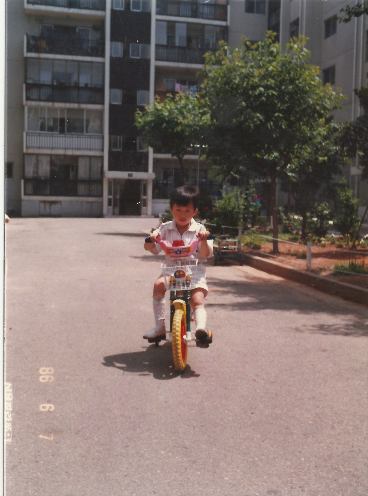
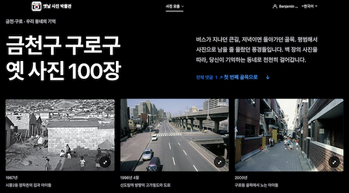

> 언젠가는 그런 서비스를 만들어보고 싶습니다.

2년 전 [옛날 사진 박물관](/essay/2024/05/01/old-photos-museum.html)이라는 글에 이렇게 썼습니다.  
그 언젠가가 드디어 왔네요. [옛날 사진 박물관](https://koreaarchive.com)을 열었습니다.

  
*남부아파트 2동과 내 첫 자전거, 1986년*

90년대 사진 박물관을 만들어야겠다고 생각한 계기가 있습니다.  
언젠가 제 고향인 금천구의 옛날 사진을 모은다는 소식을 들었습니다.    
저도 가지고 있던 사진 몇 장을 보냈습니다. 나중에 홈페이지에 들어가 보니 제가 보낸 사진들이 전시되어 있더군요. 좋네.

몇 년 뒤에 문득 생각이 나서 다시 들어가 봤습니다.  
그런데 서비스가 사라져있더라고요. 도메인조차 없어져서 아무 것도 접속이 안 되는 황당함과 허망함.  
사진을 기증한 사람들에게 안내도 안 해주고.  
참나, 공공기관이 하는 일들이 다 그렇지.

이들에게 맡기느니 그냥 내가 혼자해도 더 잘하지 않을까?  
우리나라 90년대 골목 풍경 같은 건 아직 기억하는 사람이 많은데도 막상 사진 한 장 찾아보기가 어렵습니다. 사진들이 더 없어지기 전에 모아두자.

처음 상상한 박물관은 첫 화면에 대한민국 지도가 딱 나오는 거였습니다.  
사람들이 자유롭게 옛날 사진들을 올리고 그걸 지도에서 보여주는 것.

하지만 사진 서비스는 개인이 하기에는 비용을 감당하기가 힘들 것 같더군요.  
그래서 일단 한 지역에 100장씩만 보여주기로 했습니다.
일단 이렇게라도 시작해보는거죠.

바이브 코딩 덕에 언젠가 만들어야지 하고 묵혀뒀던 것들을 꽤 많이 만들었네요.  
어느새 제가 운영하는 서비스가 열 개를 넘었습니다. 이제 피곤해서 더 만들진 않으려고요.  
하나씩 가꿔가며 키울 일만 남은 것 같습니다.

[옛날 사진 박물관](https://koreaarchive.com?utm_source=jeho_page)에서 추억의 사진을 보며 "어, 나 여기 살았는데" 댓글달고 좋아요를 누를 수 있는 따뜻한 공간이 되길 바라고 있습니다.



*함께 읽으면 좋은 글:*

* [옛날 사진 박물관](/essay/2024/05/01/old-photos-museum.html)
* [소프트웨어 DIY 시대](/essay/2026/01/27/software-diy.html)
* [아주 천천히 10만 명에 도달하는 것도 멋진 일이니까요](/essay/2026/05/07/50000-services.html)
