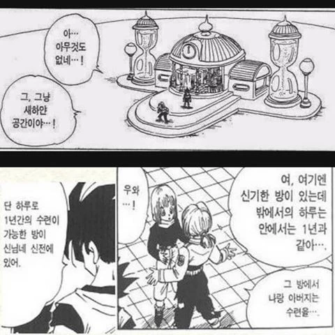
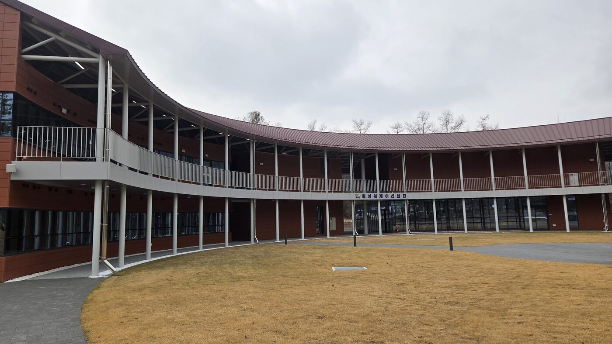
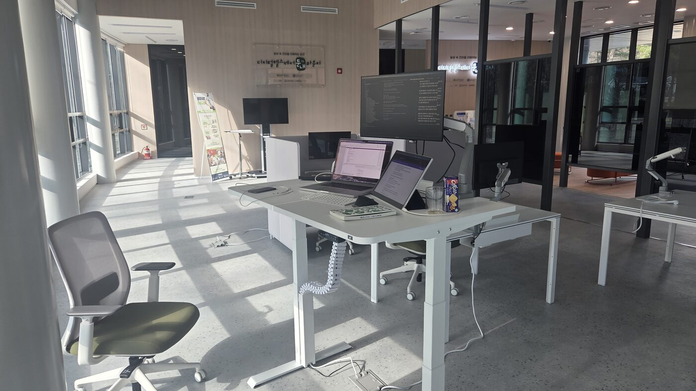
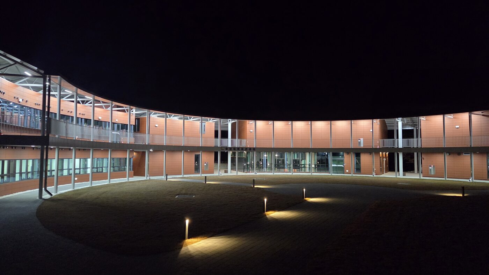
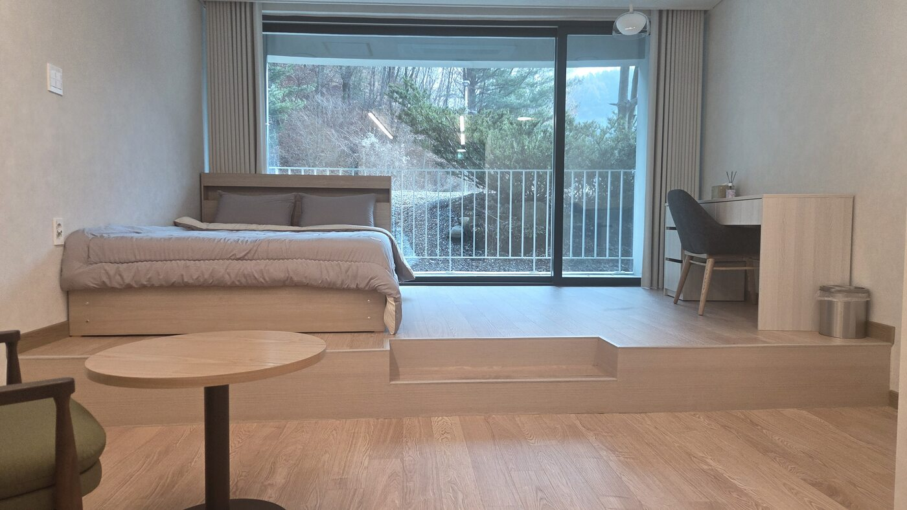
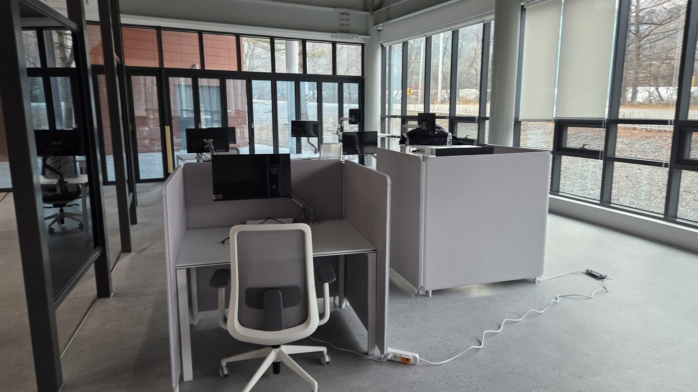
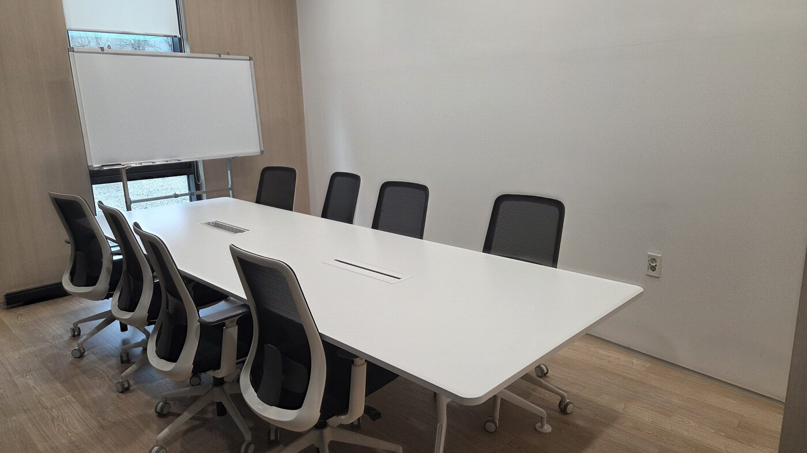
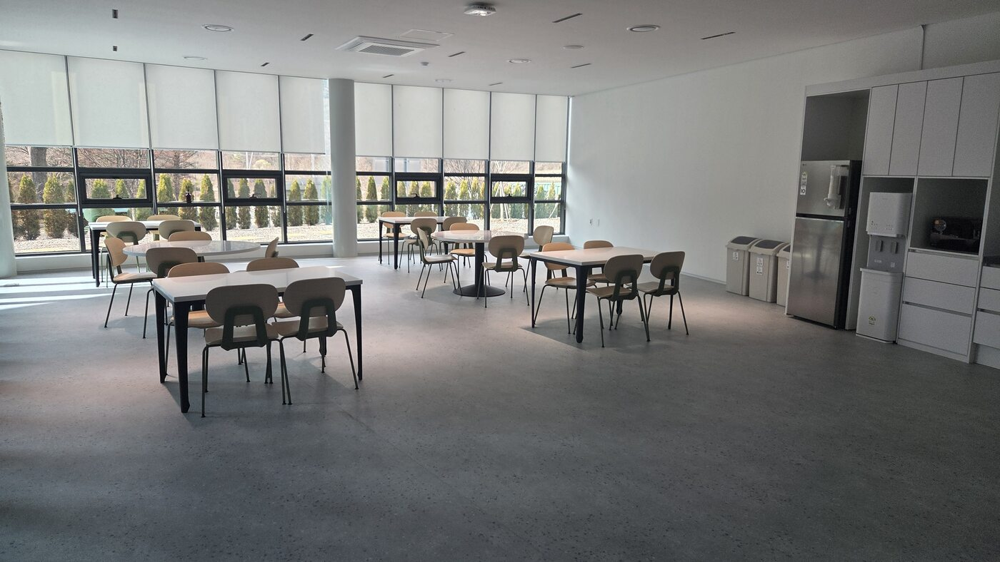
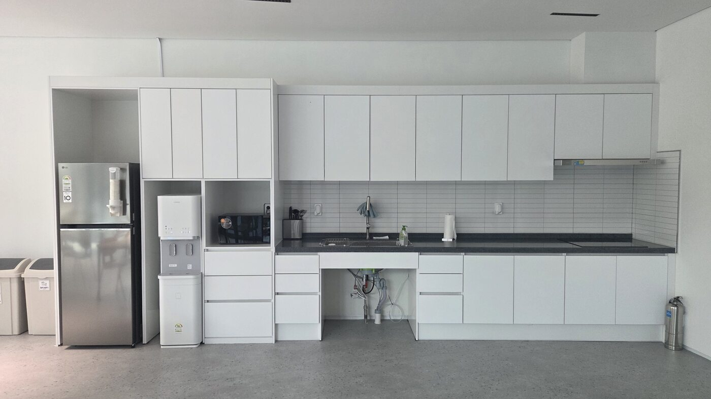

드래곤볼에는 ‘정신과 시간의 방’이라는 곳이 나옵니다.  
밖에서 하루가 지나는 동안 안에서는 1년을 보낼 수 있는 방.  
아무것도 없는 새하얀 곳에 들어가서 수련을 하고, 나오면 강해져있는 곳.

개발자에게도 저런 방이 있으면 좋겠다.  

결혼하고 나서 하루 종일 코딩을 하고 싶은 날에는 사무실에 나갑니다.  
보통은 그 정도면 충분한데, 일주일 정도 그러고 싶을 때도 있습니다.  
한 일주일 동안 집중해서 서비스 하나 완성해서 돌아올 순 없을까?  
아내도 딸도, 친구도 없는 곳. 아무도 없는 공간에서 노트북과 나만.

요즘은 저한테도 그런 방이 몇 군데 생겼습니다. 전국에 있는 워케이션 센터.  
가평에 많이 갔고 여수, 안동, 연천에도 가봤습니다. 이번에는 횡성에 처음 와봤네요.  
횡성에도 워케이션 센터가 생겼더라구요.

최근에 만들어 오픈한 [캠퍼스 커플](https://campus-couple.com)과 [옛날 사진 박물관](https://koreaarchive.com)을 정신과 시간의 방에 들어가서 만들었답니다.

  
*이번 2박 3일 동안 일했던 자리.*

여기는 숙소하고 사무실이 같은 공간에 있습니다. 이동하는 시간이 따로 들지 않아 좋습니다.  
제일 마음에 든 건 사무실을 24시간 쓸 수 있다는 것.  
다른 워케이션 오피스들은 대부분 저녁 여섯 시에 문을 닫아버리거든요.

아무도 없는 시골에서 2박 3일 동안 코딩하고 국밥 먹으며 지내는데 참 좋네요.

저는 워케이션 갈 곳을 찾을 때 주로 [디어먼데이](https://dearmonday.io/reservation/list)와 [더휴일](https://thehyuil.co.kr/programs/search)을 들여다봅니다.  
가끔 말도 안 되는 초저가의 가격들이 나오는데 그런 것은 놓치기 아깝습니다.  
저처럼 시간이 자유로운 1인 개발자들이라면 분명 좋아할 겁니다.



*함께 읽으면 좋은 글:*

* [지방에서 일주일 살기](/essay/2023/09/12/week-travel.html)
